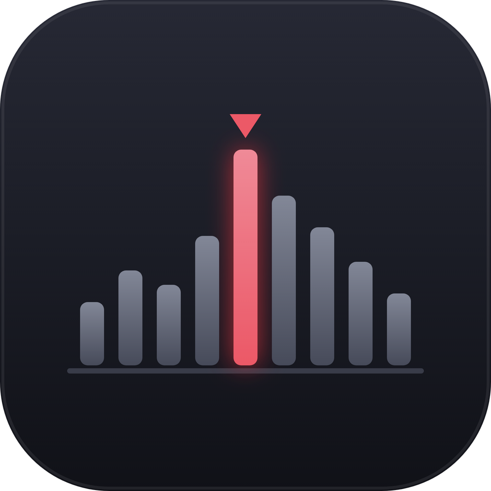

<div align="center">



# Phrase Counter

**Count the phrases in a makina track, find the drop, and keep the whole crate in one place.**

Point it at a song and it detects the BPM, locks a grid onto the actual kicks, splits the track
into blocks of 32-kick phrases, and hands you a one-line shape of the tune: `8+16+(4)+16+8`.

[](https://github.com/p0lemic/phrase-counter/releases/latest)
[](./LICENSE)

</div>

---

## What is this?

Old-school makina is built out of **phrases**: 32 kicks each, stacked into blocks, with the drop
landing exactly on a block boundary. DJs who mix this stuff by ear end up counting those phrases
manually, track by track, and writing the shape on a sticker or in a spreadsheet.

Phrase Counter does the counting. Drop in a track and you get:

```
Sonic Solutions - Nightmare       142 BPM      8+16+(4)+16+8
                                                     ▲
                                         breakdown, in parentheses
```

Every number is one block; every block is a run of 32-kick phrases. Numbers in parentheses are
**breakdowns** — the stretches with no kick at all. The drop is the boundary right after them.

## Features

| | |
|---|---|
| 🥁 **Kick-locked grid** | BPM detection via [Essentia](https://essentia.upf.edu/), then a single constant-tempo line fitted through every detected tick and slid onto the loudest kick attacks. Makina holds a locked tempo — one straight line beats re-anchoring beat by beat, by a wide margin. |
| 📐 **Phrase & block detection** | Phrases are cut every 32 kicks. Blocks are grouped by kick-band energy, so a breakdown reads as a break rather than as more of the same. |
| ✋ **Everything is editable** | Nudge the grid with ← / → (Shift = a whole kick), ±1 BPM, tap tempo, split a block in half, merge it with the next, move a bar across a boundary, flag a breakdown by hand. |
| 🌊 **Waveform you can trust** | Blocks drawn straight onto the waveform ([wavesurfer.js](https://wavesurfer-js.org/)), breakdowns shaded, click any block to hear just that block. |
| 📚 **Persistent library** | Local SQLite. Drop in files or a whole folder; analysis is cached, so reopening a song never re-runs detection. Sortable, searchable, editable title/artist. |
| 🗂️ **Collections** | Crates. A song can live in as many as you like — drag songs onto a collection in the sidebar. |
| 🎛️ **Engine DJ import** | Reads Engine DJ's own library (**strictly read-only**) and turns its playlists into collections. |
| 🏷️ **Writes back to your tags** | Stamps the result into the mp3's ID3 comment, so it shows up in Engine DJ, Rekordbox, or whatever else reads tags. |
| 📤 **Export** | The whole library — or one collection — out to CSV or JSON. |
| ⚡ **Batch analysis** | A worker pool chews through a folder in the background, with progress and an ETA. |

## Install

Grab a build from the [**latest release**](https://github.com/p0lemic/phrase-counter/releases/latest):

| Platform | File |
|---|---|
| macOS (Apple Silicon) | `Phrase Counter-*-arm64.dmg` |
| macOS (Intel) | `Phrase Counter-*.dmg` |
| Windows | `Phrase Counter Setup *.exe` |
| Linux (x64) | `Phrase Counter-*.AppImage` |

### macOS: the app is unsigned

These builds are not signed or notarized — there is no Apple Developer certificate behind them.
macOS will refuse to open the app the first time, usually with *"Phrase Counter is damaged and
can't be opened."* It isn't damaged; it's just unsigned. To get past it:

```bash
xattr -dr com.apple.quarantine "/Applications/Phrase Counter.app"
```

Then open it normally. (Or right-click the app → **Open** → **Open**.)

### Windows: SmartScreen

Same story — unsigned installer. Click **More info** → **Run anyway**.

### Linux

Make it executable and run it:

```bash
chmod +x "Phrase Counter-0.1.0.AppImage"
./"Phrase Counter-0.1.0.AppImage"
```

## Supported audio

`mp3` · `wav` · `flac` · `aiff` · `m4a` · `ogg`

ID3 comment writing only applies to mp3s.

## Build from source

Requires **Node.js 18+** (developed on Node 26). Nothing else — no Python, no compilers, no native
modules to build. Every dependency is pure JS or WASM.

```bash
git clone git@github.com:p0lemic/phrase-counter.git
cd phrase-counter
npm install
npm run dev          # hot-reloading Electron window
```

Other scripts:

```bash
npm test             # vitest — 156 unit tests over the analysis pipeline
npm run typecheck    # tsc, both the node and web projects
npm run build        # compile without packaging
```

Packaging writes installers into `release/`:

```bash
npm run package:mac      # .dmg, arm64 + x64
npm run package:win      # NSIS installer
npm run package:linux    # AppImage
```

## How it works

```
decode ─► detectRhythm (Essentia)  ─► BPM + raw kick ticks
                                        │
       bandpass 30–150 Hz ──────────────┤
                                        ▼
                          fitConstantTempoGrid   one straight line through every tick
                                        │        (keeps the tempo, drops the jitter)
                                        ▼
                          bestPhaseOffsetSec     slide the whole grid onto the
                                        │        loudest kick attacks
                                        ▼
                          phraseBoundariesSec    a cut every 32 kicks
                                        │
                                        ▼
                          groupPhrasesIntoBlocks by kick-band energy
                                        │
                                        ▼
                          markBreakdowns         blocks with no kick → (parentheses)
```

The interesting bit is the phase step. Fitting a line through the detected ticks gets the tempo
right but leaves the grid's phase wherever the ticks happened to average out — consistently just
before or just after every kick. Sliding the whole grid as one piece onto the kick-attack envelope
is what actually puts it on the beat: measured against real tracks, it captures **76–666% more
kick-attack energy** than re-anchoring tick by tick.

### Layout

```
src/
├── main/        Electron main process — SQLite, ID3 read/write, Engine DJ import, dialogs
├── preload/     the typed IPC bridge
├── renderer/    React UI
│   └── src/
│       ├── audio-analysis/   the DSP pipeline above, plus the worker pool
│       ├── collections/      crates and membership
│       ├── components/       library table, waveform view, sidebar
│       └── tags/             tag reading and filename fallbacks
└── shared/      types crossing the process boundary
```

## Where your data lives

| | |
|---|---|
| macOS | `~/Library/Application Support/phrase-counter/phrase-counter.sqlite` |
| Windows | `%APPDATA%\phrase-counter\phrase-counter.sqlite` |
| Linux | `~/.config/phrase-counter/phrase-counter.sqlite` |

That path is pinned by hand in the main process. By default Electron derives it from the app name,
which differs between `npm run dev` and the packaged app — which quietly produced **two separate
libraries** that drifted apart. The app was also once called *Drop Count*; if there is no library at
the current path but one exists at an old one (`drop-count/`, `Drop Count/`, `Phrase Counter/`), it
is copied across on first run and the old one is left behind as a backup.

### Development shortcuts

```bash
# open a file straight away instead of dragging one in every time
DROP_COUNT_DEBUG_FILE="/path/to/song.mp3" npm run dev

# use a throwaway library so you can't hurt the real one
DROP_COUNT_TEST_USERDATA_DIR="/tmp/phrase-counter-test" npm run dev
```

## The icon

The design lives in `assets/generate-icon.py`, which emits `assets/icon.svg` (full-bleed, for Linux
and the dev window) and `assets/icon-mac.svg` (with the margin macOS wants inside its squircle).
After changing it, regenerate the binaries:

```bash
npm run icons    # → assets/icon.png + icon.icns + icon.ico
```

Rasterizing is done by Electron's own Chromium (`assets/render-icon.js`), so there's no rsvg or
ImageMagick to install. The `.ico` needs Python 3 with Pillow; the `.icns` needs macOS (`iconutil`).

## A note on the language

The **interface is in Spanish** — it was built for a Spanish makina scene and hasn't been
translated. The code, comments, and this README are in English. Translations welcome.

## Contributing

Issues and pull requests are welcome. If you're touching the analysis pipeline, add a test — the
DSP modules are all covered, and it's the only way to know a change to the grid logic actually
improved anything.

## License

**AGPL-3.0-or-later.** This isn't a preference — [`essentia.js`](https://github.com/MTG/essentia.js),
which does the BPM detection, is AGPL. If you distribute this app, even privately to a closed group
rather than as a web service, you must publish your complete source under the same license.

See [`LICENSE`](./LICENSE).
